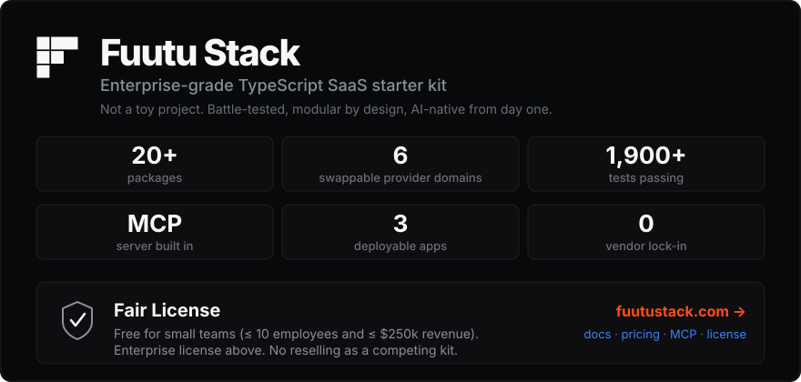
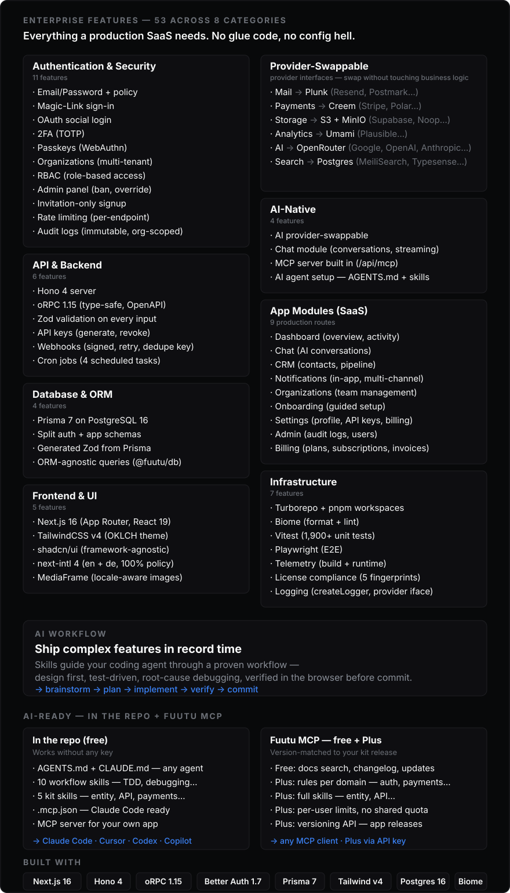

<p align="center">
  
</p>

<p align="center">
  
</p>

<p align="center">
  <a href="https://discord.gg/fF7fgQ7jZ3">💬 Discord</a> · <a href="https://docs.fuutustack.com/docs">📄 Docs</a> · <a href="https://github.com/Fuutu-company/fuutu-stack/issues">🐛 Issues</a> · <a href="./LICENSE.md">⚖ License</a>
</p>

---

## Quick Start

```bash
git clone https://github.com/Fuutu-company/fuutu-stack my-saas
cd my-saas
pnpm install
cp .env.example .env
pnpm db:start        # Postgres 16 + MinIO via docker-compose (local dev only)
pnpm db:migrate      # apply migrations (db:push skips raw-SQL constraints)
pnpm db:seed         # optional: seed admin@fuutu.local / DevPassword!2345
pnpm dev             # saas :3000 · marketing :3001 · docs :4000
```

Also: `pnpm check` (Biome) · `pnpm check-types` · `pnpm test` · `pnpm test:e2e`. Full setup, env vars and every command: [Install and run locally](https://docs.fuutustack.com/docs/getting-started/installation).

---

## What is Fuutu Stack?

A **production-grade TypeScript SaaS starter kit**, not a toy project: Next.js 16, Hono, oRPC, Better Auth, Prisma and Tailwind v4 in a pnpm + Turborepo monorepo, with auth, billing, organizations, i18n, testing and CI already wired. Every external service sits behind a typed provider interface, so you swap Plunk for Resend, Creem for Stripe or S3 for Cloudflare R2 without touching business logic.

It is also built for working with AI coding agents from the first prompt. Architecture and monorepo layout: [Architecture](https://docs.fuutustack.com/docs/concepts/architecture) · [Project structure](https://docs.fuutustack.com/docs/getting-started/project-structure).

---

## Features

- **Auth & security**: email/password, magic link, OAuth, 2FA (TOTP) and passkeys, invitation-only sign-up, admin panel, rate limiting, CSP/HSTS, open-redirect guard, immutable audit logs. [Security overview](https://docs.fuutustack.com/docs/security)
- **API**: Hono + oRPC with auto-generated OpenAPI, Zod on every input, scoped and revocable API keys, signed outbound webhooks with retry, cron jobs, and an MCP server for your own app (`/api/mcp`). [API docs](https://docs.fuutustack.com/docs/api)
- **Payments**: Creem, Stripe or Polar (alpha) behind one interface, per-seat billing, credit metering and top-ups, plans and limits in one config. [Payments](https://docs.fuutustack.com/docs/payments)
- **Organizations & RBAC**: multi-tenant orgs, invitations, seat limits, granular roles and permissions. [Organizations](https://docs.fuutustack.com/docs/organizations)
- **i18n**: next-intl, configurable locales, 100% translation policy. [i18n](https://docs.fuutustack.com/docs/i18n)
- **Provider-swappable domains**: mail, payments, storage, analytics, AI, search and logs, one active provider each and skeletons for the rest. [Provider pattern](https://docs.fuutustack.com/docs/concepts/provider-pattern)
- **AI-native**: `AGENTS.md`, 15 skills (workflow + kit) and an 8-role agent team for Claude Code (and any other agent), plus the Fuutu MCP with version-matched docs, free, and rules and full skills with MCP Plus. [Build with AI coding agents](https://docs.fuutustack.com/docs/coding-agents)
- **Many projects side by side**: every project and git worktree gets its own ports, database, buckets, cookie and browser, so agents never clash. [Port slots](https://docs.fuutustack.com/docs/getting-started/port-slots)
- **Testing & CI**: Vitest, Playwright E2E, stable visual-regression baselines with hosted diff reports, opt-in GitHub Actions. [Testing](https://docs.fuutustack.com/docs/testing)
- **Ships a demo app**: dashboard, chat, CRM, notifications, billing, admin and onboarding to learn from or replace.
- **Deployment**: Docker, Docker Compose and Coolify. [Deployment](https://docs.fuutustack.com/docs/deployment)

---

## Kit version vs. your app

Two independent identities. `KIT_NAME` and `KIT_VERSION` (`packages/config/index.ts`) belong to the kit: read-only, they change only when you merge a kit update. Your app's version is the root `package.json` `version`, and its name is `config.app.name`. Never mix them. Details and automated app releases: [Kit version vs. app version](https://docs.fuutustack.com/docs/updates/versions).

---

## License

**Free for teams with ≤ 10 employees and ≤ $250k annual revenue.** Once you exceed either threshold, you need an Enterprise License.

| Tier | Price | Who |
|---|---|---|
| **OSS** | Free | ≤ 10 employees AND ≤ $250k revenue |
| **MCP Plus** | Monthly | Anyone who wants MCP rules, full skills + versioning API |
| **Enterprise** | Yearly | Above either OSS threshold |

Full terms: **[LICENSE.md](./LICENSE.md)** · Pricing: **[fuutustack.com/pricing](https://fuutustack.com/pricing)**

---

## Links

- **Documentation**: [docs.fuutustack.com](https://docs.fuutustack.com/docs)
- **Pricing**: [fuutustack.com/pricing](https://fuutustack.com/pricing)
- **Support**: [fuutustack.com](https://fuutustack.com)
- **Contributing**: [CONTRIBUTING.md](./CONTRIBUTING.md) · **Security**: [SECURITY.md](./SECURITY.md) · **License**: [LICENSE.md](./LICENSE.md)

---

## Top Sponsors

<!-- Top-5 sponsor slots — the 5 largest sponsors by tier/size.
     Replace each placeholder with the sponsor logo + name.
     Updated manually on sponsorship changes. -->
<p align="center">
  <a href="https://fuutustack.com/sponsors">Sponsor&nbsp;1</a> ·
  <a href="https://fuutustack.com/sponsors">Sponsor&nbsp;2</a> ·
  <a href="https://fuutustack.com/sponsors">Sponsor&nbsp;3</a> ·
  <a href="https://fuutustack.com/sponsors">Sponsor&nbsp;4</a> ·
  <a href="https://fuutustack.com/sponsors">Sponsor&nbsp;5</a>
</p>

<p align="center">
  <a href="https://fuutustack.com/sponsors">See all supporters →</a>
</p>
